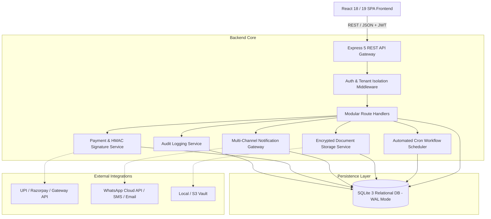
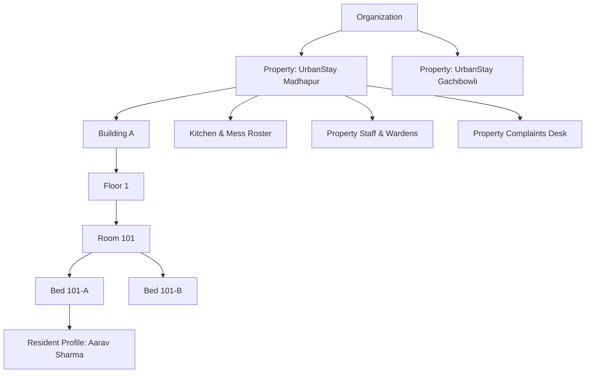

# 🏗️ StayOS System Architecture Documentation

This document outlines the architectural blueprint, data flow diagrams, security boundaries, and modular structure of the **StayOS** SaaS platform.

---

## 1. High-Level System Architecture

StayOS uses a decoupled multi-tier architecture with a unified single-tenant database partitioning strategy (multi-tenant shared schema with strict tenant identifier enforcement).



---

## 2. Multi-Tenant Organizational Hierarchy

Data in StayOS is organized in an organizational tree. Every major resource belongs to an `organization_id`, and properties provide sub-scoping within that organization:



---

## 3. Core Subsystems

### 3.1 Authentication & RBAC Middleware
- **JWT Authentication**: Tokens carry `id`, `organization_id`, `email`, `role`, and `properties`.
- **Tenant Isolation**: Middleware guarantees that requests only query rows where `organization_id` matches the authenticated caller's token.
- **Role Permissions**: `requireRole(allowedRoles)` strictly blocks unauthorized routes at the server level, preventing privilege escalation.

### 3.2 Payment Verification & Financial Integrity Engine
- **Idempotency & Fraud Prevention**: Client requests cannot forge payment amounts. The backend queries the referenced invoice from the database, computes required amounts, generates a cryptographic HMAC signature, and checks the signature before marking invoices as `paid`.
- **Atomic Checkout Settlements**: Resident checkout computes unpaid rent + penalties − refundable security deposits in a single ACID transaction before releasing the bed.

### 3.3 Food & Chef Kitchen Display System (KDS)
- Weekly meal schedules specify Breakfast, Lunch, Snacks, and Dinner menus.
- Real-time participating headcount calculation = `Total Active Residents - Opt-Outs / Leaves`.
- 1-Click "Meal Ready" trigger invokes `NotificationService` to push broadcast alerts across in-app, SMS, and WhatsApp channels.

### 3.4 Automated Background Cron Scheduler
- Runs daily background automations:
  - **Rent Due Reminders**: Evaluates upcoming invoices at 7 days, 3 days, and on due date.
  - **Overdue Tagging**: Detects invoices past grace periods and flags them as `overdue`.
  - **Recurring Invoices**: Generates next month's recurring rent invoices for active resident stays.
  - **Meal Attendance Prep**: Pre-populates daily meal rosters for the kitchen staff.

---

## 4. Frontend Component Hierarchy

```
App.jsx
 ├── LandingPage.jsx (Public Marketing & Pricing)
 ├── LoginPage.jsx (Role Switcher & JWT Handler)
 ├── OnboardingWizard.jsx (New PG First-Time Setup)
 └── AppLayout.jsx (Authenticated Shell)
      ├── TopNavbar.jsx (Active Property Selector, Profile, Alerts)
      ├── NotificationDrawer.jsx (Real-time alert drawer)
      ├── QuickActionModal.jsx (Global +Resident, +Payment, +Complaint)
      └── Main View Router
           ├── DashboardPage.jsx (Dynamic KPIs & Recharts)
           ├── PropertiesPage.jsx (Multi-Property CRUD)
           ├── RoomsPage.jsx (Interactive Matrix)
           ├── BedsPage.jsx (Vacant Bed Finder)
           ├── ResidentsPage.jsx & CheckOutModal.jsx
           ├── CheckInWizardPage.jsx (4-Step Onboarding)
           ├── InvoicesPage.jsx (Billing & PDF generator)
           ├── PaymentsPage.jsx (UPI QR & Receipts)
           ├── ExpensesPage.jsx (Expense Ledger)
           ├── FoodManagementPage.jsx (Weekly Menu)
           ├── ChefDashboardPage.jsx (Live KDS Screen)
           ├── ComplaintsPage.jsx (Ticket Lifecycle)
           ├── MaintenancePage.jsx (Work Orders)
           ├── StaffPage.jsx (Staff Roster & Attendance)
           ├── VisitorsPage.jsx (Gate Passes)
           ├── NoticesPage.jsx (Broadcasts)
           ├── ReportsPage.jsx (Analytics & CSV Export)
           ├── SettingsPage.jsx (GST, Rules, Manual Cron Trigger)
           ├── SuperAdminPage.jsx (Platform Console)
           └── ResidentPortalPage.jsx (Mobile-First Resident WebApp)
```

---

## 5. Extensibility & Cloud Deployment
- **Database Switch**: While SQLite WAL mode is configured for fast embedded performance, the schema uses standard ANSI SQL and is easily ported to PostgreSQL or MySQL via Prisma / Knex / Drizzle.
- **Storage Driver**: `storageService.js` abstracts file writes, allowing drop-in replacement with AWS S3, Cloudflare R2, or Supabase Storage.
- **Messaging Providers**: `notificationService.js` exposes interface hooks for Twilio, Meta WhatsApp Cloud API, Resend, or SendGrid.
