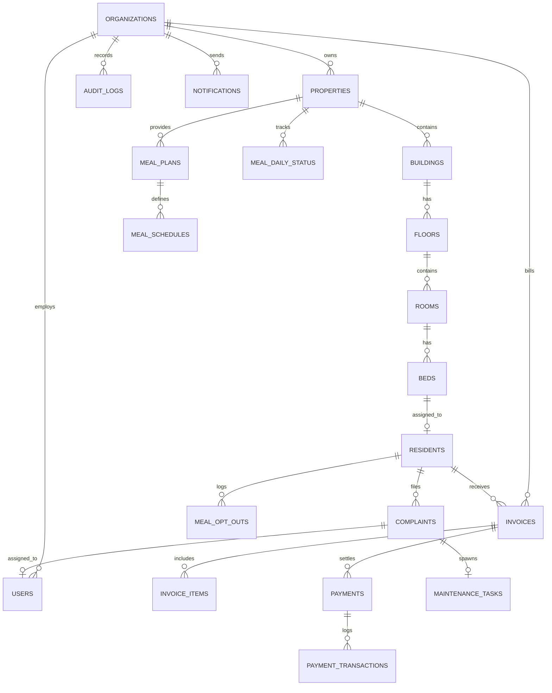

# 🗄️ StayOS Relational Database Schema Documentation

StayOS uses a normalized relational schema with 29 core entities, foreign key integrity constraints, and query indexes.

---

## 1. Entity-Relationship Diagram (Core Domains)



---

## 2. Table Directory & Schema Breakdown

### 2.1 Multi-Tenant & Hierarchy
- `organizations`: Root tenant entity (name, slug, subscription_plan, status, GSTIN, rent rules).
- `properties`: Physical accommodation locations (name, type, address, city, pincode, contact).
- `buildings`: Physical building blocks in a property campus.
- `floors`: Floors within a building (floor_number, name).
- `rooms`: Rooms (room_number, floor_id, property_id, room_type, capacity, is_ac, rent_amount, deposit_amount).
- `beds`: Individual rentable beds (bed_number, room_id, status: `available`/`occupied`/`maintenance`/`blocked`).

### 2.2 User Accounts & RBAC
- `users`: Authenticated accounts (email, password_hash, full_name, phone, role: `super_admin` | `owner` | `manager` | `accountant` | `warden` | `receptionist` | `chef` | `kitchen_staff` | `maintenance` | `resident`, status).
- `user_properties`: Multi-property permission mapping for staff.

### 2.3 Residents & Stays
- `residents`: Resident master records (user_id, organization_id, full_name, phone, email, gender, dob, emergency_contact, id_type, id_number, college_or_company, food_preference).
- `resident_stays`: Track active, notice, or completed stays (resident_id, property_id, bed_id, joining_date, checkout_date, monthly_rent, deposit_amount, status: `active` | `notice` | `checked_out`).
- `resident_documents`: Identity proofs, lease agreements, and KYC documents.

### 2.4 Invoicing & Financial Ledger
- `invoices`: Billing records (invoice_number, organization_id, property_id, resident_id, billing_month, subtotal, tax_amount, discount, total_amount, paid_amount, status: `pending` | `partially_paid` | `paid` | `overdue` | `void`, due_date).
- `invoice_items`: Line item breakdown (rent, deposit, electricity, mess, late fee).
- `payments`: Verified payment records (receipt_number, invoice_id, amount, payment_method: `upi` | `cash` | `bank_transfer` | `card`, transaction_id, status: `success` | `pending` | `failed` | `refunded`, paid_at).
- `payment_transactions`: Gateway attempt log with HMAC verification signatures.
- `expenses`: Property expenditure ledger (property_id, category: `food` | `electricity` | `maintenance` | `salaries` | `supplies` | `other`, amount, vendor, description, receipt_file).

### 2.5 Food & Kitchen
- `meal_schedules`: 7-day recurring menu items (property_id, day_of_week, meal_type: `breakfast` | `lunch` | `snacks` | `dinner`, menu_items).
- `meal_daily_status`: Chef KDS daily state (property_id, date, meal_type, status: `scheduled` | `preparing` | `ready` | `completed`, expected_count, served_count).
- `meal_opt_outs`: Resident meal skip declarations.

### 2.6 Operations & Facility Desk
- `complaints`: Resident tickets (property_id, resident_id, room_id, category, priority, status: `submitted` | `assigned` | `in_progress` | `resolved`, assigned_to_user_id).
- `maintenance_tasks`: Work orders for repairs (property_id, complaint_id, technician_user_id, estimated_cost, actual_cost, status).
- `staff_attendance`: Staff clock-ins/outs (user_id, date, check_in_time, check_out_time, status: `present` | `absent` | `half_day` | `leave`).
- `visitors`: Gate pass requests (resident_id, visitor_name, phone, purpose, date, check_in_time, check_out_time, status: `pending` | `approved` | `rejected`).
- `notices`: Broadcast announcements (organization_id, property_id, title, content, target_audience).
- `notifications`: User notification delivery log (user_id, title, message, channel: `in_app` | `email` | `whatsapp` | `sms`, read_status).
- `notification_preferences`: Per-user channel toggles.

### 2.7 Platform Governance & Subscriptions
- `plans`: SaaS subscription packages (Starter, Growth, Professional, Enterprise) with max_properties, max_beds, and pricing.
- `subscriptions`: Tenant subscription status and renewal dates.
- `audit_logs`: Immutable security audit trail with user, action, entity, IP, and metadata.

---

## 3. Database Indexes & Performance Optimization

```sql
CREATE INDEX idx_properties_org ON properties(organization_id);
CREATE INDEX idx_rooms_property ON rooms(property_id);
CREATE INDEX idx_beds_room ON beds(room_id);
CREATE INDEX idx_beds_status ON beds(status);
CREATE INDEX idx_resident_stays_bed ON resident_stays(bed_id);
CREATE INDEX idx_resident_stays_status ON resident_stays(status);
CREATE INDEX idx_invoices_resident ON invoices(resident_id);
CREATE INDEX idx_invoices_status ON invoices(status);
CREATE INDEX idx_invoices_due_date ON invoices(due_date);
CREATE INDEX idx_payments_invoice ON payments(invoice_id);
CREATE INDEX idx_complaints_property ON complaints(property_id);
CREATE INDEX idx_complaints_status ON complaints(status);
CREATE INDEX idx_audit_logs_org ON audit_logs(organization_id);
CREATE INDEX idx_notifications_user ON notifications(user_id, is_read);
```
